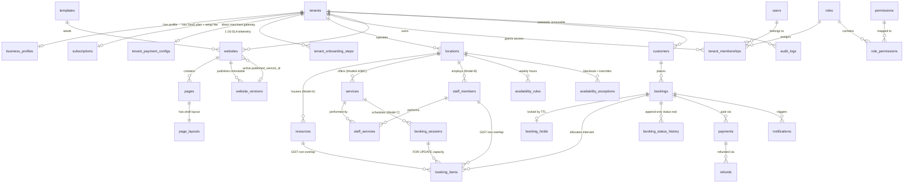

# 02 — Database ERD, Schema Reference & Booking Concurrency Strategy

## 1. Entity-Relationship Diagram (Mermaid)



---

## 2. Complete 34-Table Schema Inventory & Isolation Strategy

All Drizzle table definitions reside in [`src/db/schema/`](../../src/db/schema/) with PostgreSQL exclusion/check constraints in [`src/db/migrations/0000_foundation_constraints.sql`](../../src/db/migrations/0000_foundation_constraints.sql).

### Key PRD v2.0 & Market Research Schema Alignments
- **Full Booking Status Lifecycle & Immutable Transition Ledger (PRD §7.7)**: `booking_status` includes `'temporarily_held'`, `'pending_payment'`, `'confirmed'`, `'cancelled'`, `'expired'`, `'completed'`, `'no_show'`, `'refund_pending'`, `'refunded'`; every state change appends an immutable row to `booking_status_history`.
- **Cross-Midnight & Variable-Duration Turf Scheduling (PRD §6.1, §7.4; Market Research §4.1)**: `availability_rules.spans_midnight` handles late-night sports venues (e.g., `18:00` to `02:00` next day), and `resources` defines `min_duration_minutes`, `max_duration_minutes`, and `slot_step_minutes`.
- **Client-Direct Merchant Accounts & Simulated MVP Payments (PRD §9, §17; Market Research §9.4)**: `tenant_payment_configs` maps each tenant to `'simulated'` (MVP P0) or client-owned `'razorpay'` / `'cashfree'` / `'stripe'` accounts via Vault secret references so client funds are not held centrally.
- **1–2 Day Turnaround Telemetry (PRD §16, §19)**: `tenant_onboarding_steps` measures duration across each step of internal website setup, and `subscriptions` tracks both `setup_fee_minor` and `recurring_amount_minor` (Market Research §9.3).

### Tenant Ownership & Isolation Rules
1. **Global Platform Tables (`tenant_id` absent or nullable)**:
   - `tenants`, `users`, `permissions`, `role_permissions`, `templates`, `widget_definitions`, `payment_webhook_events` (`tenant_id` populated post-lookup), `roles` (`tenant_id IS NULL` for system roles), `audit_logs` (`tenant_id IS NULL` for super-admin global actions).
2. **Strict Tenant-Owned Tables (`tenant_id UUID NOT NULL REFERENCES tenants(id)`)**:
   - `tenant_memberships`, `business_profiles`, `locations`, `subscriptions`, `tenant_payment_configs`, `tenant_onboarding_steps`, `websites`, `pages`, `page_layouts`, `website_versions`, `resources`, `services`, `staff_members`, `staff_services`, `availability_rules`, `availability_exceptions`, `booking_sessions`, `customers`, `bookings`, `booking_holds`, `booking_items`, `booking_status_history`, `payments`, `refunds`, `notifications`.
3. **Two-Layer Enforcement**:
   - **Application Layer**: Every repository/service query explicitly filters `WHERE tenant_id = $tenantId` derived from the verified host or authenticated membership—never from raw client body fields alone.
   - **Database Layer (`withTenantTransaction`)**: Sets `SET LOCAL app.current_tenant_id = '<uuid>'` per transaction so PostgreSQL RLS policies block accidental cross-tenant reads/writes even if a query omits a filter.

---

## 3. Solving the 23-Simultaneous-Customers Concurrency Scenario

**Scenario**: 23 customers click "Book Now" at the exact same millisecond for the last remaining slot (e.g., *Turf 1 from 8:53 PM to 10:53 PM IST*, or the *final spot in a 7:00 AM Yoga Session*).

### 3.1 Model A (Exclusive Resource) & Model B (Staff Appointment)
1. **Request Intake**: Client sends `POST /api/public/v1/holds` with required `Idempotency-Key` header.
2. **Transaction Start**: `withTenantTransaction(tenantId, async (tx) => { ... })`.
3. **Idempotency Check**: Query `bookings` by `(tenant_id, idempotency_key)`. If present, return the existing hold deterministically.
4. **Lazy Hold Expiry**: Before inserting, atomically release any expired holds overlapping the target window:
   ```sql
   WITH expired AS (
     UPDATE booking_holds
     SET status = 'expired', released_at = now()
     WHERE tenant_id = $1 AND status = 'active' AND expires_at <= now()
     RETURNING booking_id
   ),
   updated_bookings AS (
     UPDATE bookings SET status = 'expired', updated_at = now()
     WHERE id IN (SELECT booking_id FROM expired) AND status IN ('temporarily_held', 'pending_payment')
   )
   UPDATE booking_items SET allocation_status = 'released'
   WHERE booking_id IN (SELECT booking_id FROM expired) AND allocation_status = 'active';
   ```
5. **Atomic Interval Allocation**: Insert `bookings` (`status = 'temporarily_held'`), `booking_holds` (`expires_at = now() + interval '8 minutes'`), and `booking_items` (`allocation_status = 'active'`, `buffer_starts_at`, `buffer_ends_at`).
6. **Database GiST Exclusion Enforcement**:
   PostgreSQL evaluates `excl_booking_items_resource_overlap` (or `excl_booking_items_staff_overlap`):
   ```sql
   EXCLUDE USING gist (
     resource_id WITH =,
     tstzrange(buffer_starts_at, buffer_ends_at, '[)') WITH &&
   ) WHERE (resource_id IS NOT NULL AND allocation_status = 'active')
   ```
   - **Winner (1 of 23)**: Acquires the GiST index lock, commits cleanly, and receives `201 Created` with `holdToken` and `expiresAt`.
   - **Losers (22 of 23)**: PostgreSQL immediately aborts their `INSERT` with **`SQLSTATE 23P01` (`exclusion_violation`)**. The service maps `23P01` to `SlotUnavailableError` (`409 Conflict`). Zero double-bookings are mathematically possible.

### 3.2 Model C (Capacity-Based Sessions)
1. Lock the parent session row exclusively:
   ```sql
   SELECT id, max_capacity, booked_count, held_count
   FROM booking_sessions
   WHERE id = $1 AND tenant_id = $2
   FOR UPDATE;
   ```
2. Release any expired holds tied to `session_id` (`expires_at <= now()`) and decrement `held_count` in the same transaction.
3. Verify `booked_count + held_count + requested_qty <= max_capacity`.
4. Update `held_count = held_count + requested_qty` (additionally guarded by `chk_booking_sessions_capacity_bounds` at the table level).
5. All 23 concurrent transactions serialize cleanly on the `FOR UPDATE` lock; once `booked_count + held_count == max_capacity`, subsequent transactions immediately fail with `SessionCapacityExceededError` (`409 Conflict`).

### 3.3 Payment Webhook Idempotency & Late-Payment Recovery
1. **Signature First**: Verify `x-razorpay-signature` over raw request bytes using `crypto.timingSafeEqual` before parsing JSON.
2. **Webhook Deduplication**:
   ```sql
   INSERT INTO payment_webhook_events (provider, provider_event_id, event_type, signature_verified, payload)
   VALUES ('razorpay', $eventId, $type, true, $payload)
   ON CONFLICT (provider, provider_event_id) DO NOTHING
   RETURNING id;
   ```
   Duplicate retries from Razorpay return `0` rows and exit cleanly with `200 OK`.
3. **Normal Path (Hold Still Active)**: Lock `bookings` + `booking_holds` (`FOR UPDATE`). Transition `bookings.status = 'confirmed'`, `bookings.payment_status = 'paid'`, `booking_holds.status = 'converted'`. If Model C, move `quantity` from `held_count` to `booked_count`.
4. **Edge Path (Delayed UPI Callback Arrives After Hold Expired)**:
   - Open `SAVEPOINT reactivate_expired_hold`.
   - Attempt `UPDATE booking_items SET allocation_status = 'active' WHERE booking_id = $id` (or re-increment `booked_count` on `booking_sessions`).
   - **Case 4A (No one else booked the slot yet)**: Savepoint succeeds! Booking transitions to `confirmed`—customer gets their slot seamlessly.
   - **Case 4B (Another customer already booked the slot)**: `23P01` / `23514` is caught; `ROLLBACK TO SAVEPOINT reactivate_expired_hold`; `payments.status` is recorded as `'captured_requires_refund'`, a `refunds` row is inserted, an automated Razorpay Refund API job is triggered, and both customer & business owner are notified. **No payment is ever lost or untracked, and no duplicate booking is ever created.**
