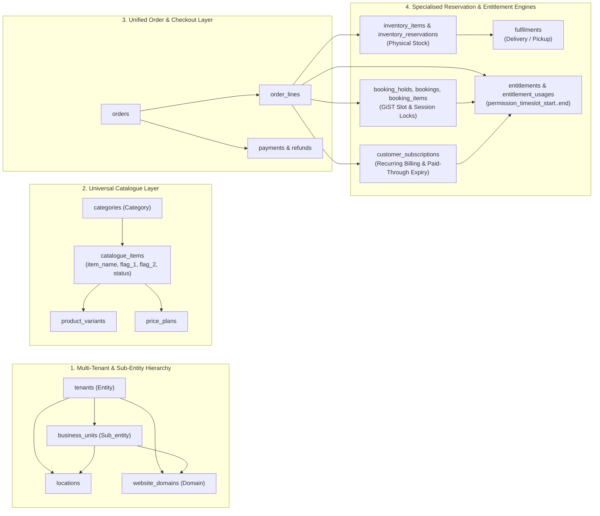

# Architecture Blueprint 05 — Universal Commerce & Entitlement Engine

## 1. Architectural Overview
This document specifies the Phase 2+ target architecture that extends the Multi-Tenant Website Builder & Booking Platform into a **Universal Commerce & Entitlement Platform** (*"Sell an item, grant a right"*).

---

## 2. Master Data Table Projection (`v_universal_commerce_master`)
To support flat operational inspection, BI exports, and single-slot master ledger rendering while keeping transactional tables in 3NF, the database defines `v_universal_commerce_master`:

| Master View Column | Source Table & Column | Description |
| :--- | :--- | :--- |
| `entity` | `tenants.name` (`tenants.slug`) | Top-level company / organisation |
| `sub_entity` | `COALESCE(business_units.name, locations.name, 'Main Division')` | Brand, division, branch, or department |
| `domain` | `COALESCE(website_domains.domain, tenants.slug || '.platform.in')` | Resolved storefront domain |
| `category` | `COALESCE(categories.name, catalogue_items.item_type::text)` | Offering category |
| `flag_1` | `catalogue_items.flag_1` | Custom merchant/system flag 1 (e.g., `'perishable_daily'`, `'electronics'`, `'peak_floodlit'`) |
| `flag_2` | `catalogue_items.flag_2` | Custom merchant/system flag 2 (e.g., `'morning_slot'`, `'90_day_window'`, `'ready_to_upgrade'`) |
| `item_name` | `catalogue_items.name` | Canonical item or offering title |
| `permission_timeslot_start` | `COALESCE(entitlements.valid_from, booking_items.slot_start)` | Start of customer's granted usage/viewing window |
| `permission_timeslot_end` | `COALESCE(entitlements.valid_until, booking_items.slot_end)` | End of customer's granted usage/viewing window |
| `status` | Composite lifecycle projection (`dormant`, `unavailable`, `available`, `sold`, `ready_to_upgrade`, `expired`) | Current commercial or entitlement status |
